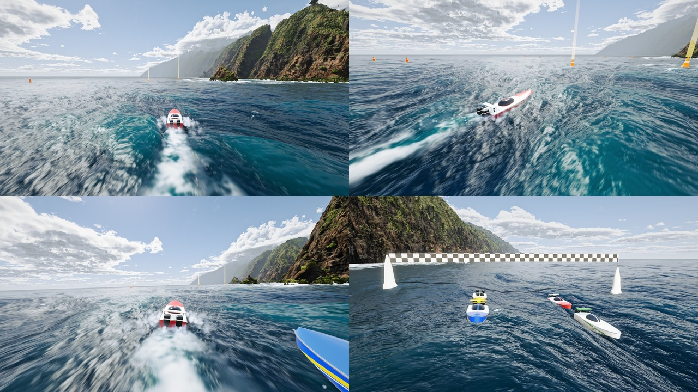

# napali

A drone flight over the Na Pali coast (Kauai), rendered entirely in code.

No textures, no images, no 3D models, no downloaded assets. Terrain, erosion, coastline, ocean, surf and foam, reefs,
palms and forest, rock, clouds, haze, lighting and the colour grade are all generated in WebGL2 shaders and a little
JavaScript, in a single self-contained `index.html`.


Built with Claude Code (Claude Opus 5.5) over 13 rounds of agent work, most of them with parallel specialists for water,
sky, terrain and vegetation, a merge step, and a judge that compared each round against a set of reference photos of the
coast.

## Run it

Open `index.html` in a recent Chrome (or any browser with WebGL2) and wait for the shaders to compile. The first load can
take 30-90 s; after that it starts quickly.

| URL | What it shows |
|---|---|
| `index.html` | the drone flight in real time |
| `index.html?mode=still` | the final aerial composition as a high-quality still (`&spp=16` by default) |
| `index.html?mode=race` | 納帕利海岸賽艇: a powerboat race along the coast (see below) |

In the flight view: `Space` pause, `R` restart, `←` / `→` skip 5 s, `F` fullscreen, `H` toggle the HUD.

The page needs a decent GPU. It was developed on a laptop with an integrated GPU, where a 1672x941 frame takes about
1-2 s offline, so the real-time view drops resolution automatically.

## Powerboat race



`index.html?mode=race` turns the scene into a game: four offshore powerboats race laps of a buoyed course under the
cliffs, round the sea stacks and back offshore. You start at the back of the grid against three AI crews (Kalalau,
Hanakāpīʻai, Nuʻalolo). Pass between the orange pylons of every gate; the next one glows and has light beams over it.

| Key | Action |
|---|---|
| `W` / `↑` | throttle |
| `S` / `↓` | brake, reverse |
| `A` `D` / `←` `→` | steer |
| `Shift` / `Space` | boost (the bar under the speedometer, recharges) |
| `C` | camera: chase, far chase, bow, TV helicopter |
| `R` | back to the last gate (after a missed gate or a crash) |
| `P` / `Esc` | pause; the paused frame keeps refining at full resolution (photo mode) |
| `M` | mute |
| `H` | hide / show the HUD |
| `Enter` | start, race again |

A gamepad works too (left stick, triggers, A to boost, Start). URL options: `laps=3` (default 2), `ai=1.0` (rival
pace, default 0.96), `mute=1`, `hud=0`.

The boats are part of the same picture, not stickers on it. They, the pylons, wakes and spray are rasterised into the
ray march's HDR buffer before the post chain, depth-tested against its hit distance (a second render target) so waves,
sea stacks and headlands hide them, and shaded by shaders compiled on top of the scene shader: the same sun, sky fill,
sky reflections (`skyRefl`), cliff shadows (`shadowH`) and haze (`fogApply`) as the land and the sea, foam lit like the
surf. A sun shadow map puts their shadows on deck and on the water. The hulls ride the real FFT ocean: every frame a
probe pass runs the water shader's own `oceanH()` under each hull and pylon. The coast collision uses the generator's
coastline distance field. Engine, water and countdown sounds are synthesised with Web Audio. Like the flight view it
needs a good GPU; the real-time resolution adapts to keep the frame rate up.

Race stills at full quality (jittered samples spread over a shutter interval, as `video.mjs` renders the flight):

```bash
# sim = seconds of racing on autopilot (0 = the start grid), cam 0 chase / 1 far chase / 2 bow / 3 TV, hud=1 keeps the HUD
node tools/race_shot.mjs race.png "sim=30&cam=0&spp=16&shutter=0.25" 1920 1080
```

## Render a video

The tools in `tools/` drive headless Chrome over the DevTools protocol. They need Node 22+, Chrome and ffmpeg on the PATH.

```bash
# a still of the final aerial composition (shot.mjs renders mode=still)
node tools/shot.mjs out.png "spp=4&hud=0"

# the whole flight: out.mp4 width height fps samples-per-frame extra-url-params
node tools/video.mjs flight.mp4 1920 1080 30 4 "hud=0&bandpx=5000"

# contact sheet of single frames at the given flight times (seconds)
node tools/video.mjs --sheet sheet.png "10,40,80,120" 960 540 "hud=0"
```

Useful environment variables for `video.mjs`:

| Variable | Effect |
|---|---|
| `SPEED=2.5` | play the flight 2.5x faster (motion blur is scaled to match) |
| `T0=11 T1=22` | render only that part of the video (seconds of video), e.g. to render in crash-safe segments |
| `FRAME_PAUSE_MS=60` | let the GPU idle between frames |
| `ANGLE=vulkan` | ANGLE backend (much faster shader compile than D3D11 on Windows) |
| `CHROME=/path/to/chrome` | Chrome binary if it is not in the default location |

Only one render runs on the GPU at a time: `tools/cdp.mjs` holds a machine-wide lock in the temp folder and rests the GPU
for 20 s after each render. `bandpx` splits each frame into smaller GPU chunks. Both exist because several parallel
renders crashed the graphics driver on an integrated GPU.

The published video was rendered at 1080p30 with 4 samples per frame and `SPEED=2.5` (1,584 frames).

## Build from the parts

`index.html` is generated. Edit the parts in `tools/` and rebuild:

```bash
node tools/rebuild.cjs
```

| File | Contents |
|---|---|
| `v2_template_backup.html` | page, terrain generation and erosion passes, FFT ocean, post-processing chain |
| `v3_geo.glsl` | signed-distance geometry: terrain, rock relief, trees, palms, canopy, ray march, shadows |
| `v3_shade.glsl` | materials and lighting for land, rock, sand and vegetation |
| `v4_water.glsl` | water shading: depth colour, reefs, foam, surf, glints |
| `v4_sky.glsl` | sky dome, volumetric cumulus, cirrus |
| `tweaks.cjs` | string patches on the template: vegetation mask, beach profile, haze, the colour grade |
| `patch_v3.cjs`, `patch_v4.cjs` | splice the GLSL parts and the plant placement pass into the template |
| `v2_flight.js` | camera paths (cinematic flight and FPV keys) |
| `race.js`, `patch_race.cjs` | the powerboat race (`mode=race`) and its hooks in the template |
| `race_shot.mjs` | headless race stills (`mode=race`, multi-sample, motion blur) |
| `v2_coast.txt`, `v2_coastsdf.txt`, `v2_build.txt` | coastline polygon and terrain build data |

Most look parameters are exposed as URL knobs (see `num('...')` calls in the page), so they can be tuned without a rebuild.

## Credits

- Code: Leon Lin ([@LexnLin](https://x.com/LexnLin)), built with [Claude Code](https://claude.com/claude-code).
- The music in the published video is "Heroic Age" by Kevin MacLeod ([incompetech.com](https://incompetech.com)),
  licensed under [Creative Commons: By Attribution 4.0](http://creativecommons.org/licenses/by/4.0/). It is not part of
  this repository.
- The reference photos used to judge the renders are not included.

## License

[MIT](LICENSE)
